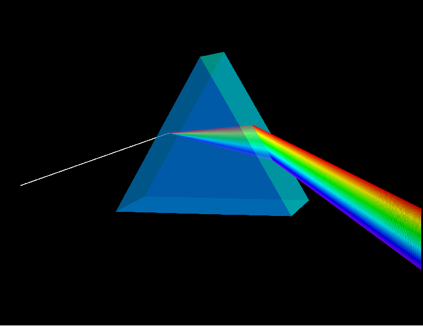

# Física per a Ciències Biomèdiques

Notes de classe de física per al primer curs d'un grau de l'àrea de les ciències
biomèdiques, escrites per Raimon Luna i Perelló (Universitat de Barcelona).

📄 El PDF compilat es pot descarregar des de la meva [pàgina de docència](https://raimonluna.github.io/teaching.html).

<p align="center">
  
</p>

## Contingut

El text és una introducció a la física clàssica amb un mínim formalisme
matemàtic, pensada per a estudiants de ciències biomèdiques. Està organitzat
en tres blocs:

- **Física de fluids**: estàtica de fluids, dinàmica de fluids ideals i fluids
  viscosos.
- **Calor i termodinàmica**: principis de la termodinàmica, calorimetria i
  mecanismes de transmissió de la calor.
- **Ones i fenòmens ondulatoris**: ones mecàniques i sonores, i ones
  electromagnètiques i òptica.

Al llarg del text es dona molta importància al suport visual de cada concepte
mitjançant il·lustracions esquemàtiques i simulacions.

## Estructura del repositori

```
.
├── FisicaCienciesBiomediques.tex   # Codi font LaTeX del document principal
├── Material/
│   ├── PlotsBioteckMathematica.nb  # Llibreta Mathematica: figures geomètriques 3D
│   ├── PlotsBioteckPython.ipynb    # Llibreta Jupyter: figures 2D en Python
│   ├── AnimacionsClasse.ipynb      # Llibreta Jupyter: animacions per a classe
│   ├── Harmonics_corda.mscz        # Partitura (MuseScore) sobre harmònics d'una corda
│   └── chapter_split.sh            # Script per dividir el PDF final en capítols
├── portada.png
├── LICENSE
└── README.md
```

Les figures basades en visualitzacions geomètriques 3D estan generades amb
Mathematica, mentre que les representacions 2D i les animacions provenen de
codi en Python (Jupyter). Algunes simulacions (per exemple, mètodes de
*lattice Boltzmann* o transformacions de Joukowsky) es troben també a les
llibretes corresponents.

## Compilació del document

El document es compila amb LaTeX (`pdflatex` o `latexmk`):

```bash
latexmk -pdf FisicaCienciesBiomediques.tex
```

L'script `Material/chapter_split.sh` permet dividir el PDF resultant en un
fitxer per capítol.

## Requisits

- Una distribució LaTeX (TeX Live, MiKTeX, etc.)
- [Wolfram Mathematica](https://www.wolfram.com/mathematica/) per obrir i
  executar `PlotsBioteckMathematica.nb`
- Python 3 i Jupyter per obrir i executar les llibretes `.ipynb`

## Llicència

Aquest projecte es distribueix sota la llicència GPL-3.0 (vegeu [LICENSE](LICENSE)).
